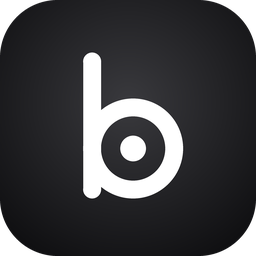
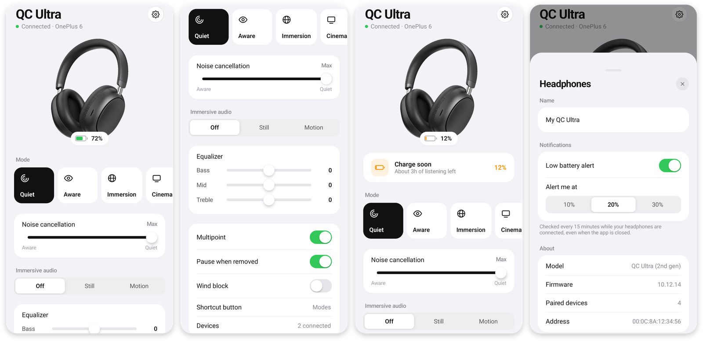
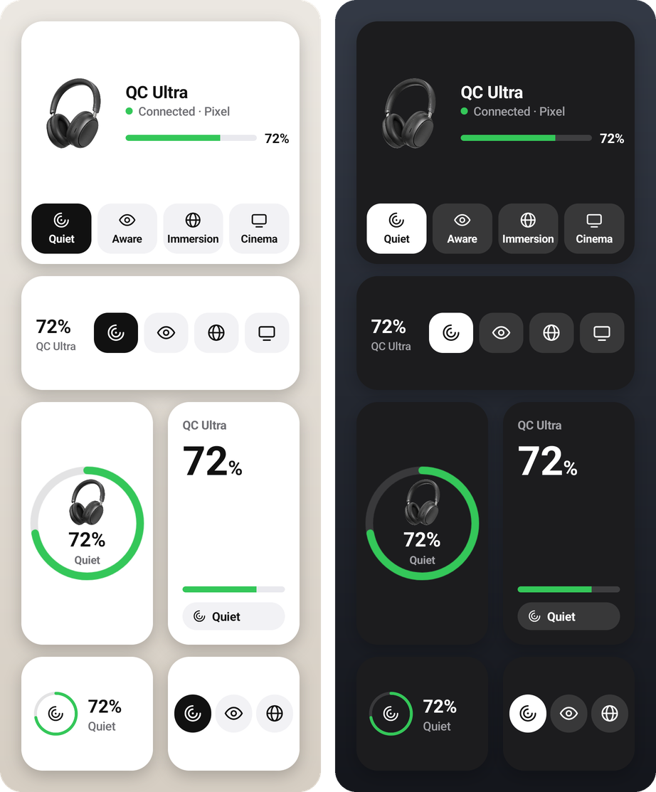

<p align="center">
  
</p>

<h1 align="center">BetterBose</h1>

<p align="center">
  A fast, quiet Android app for the Bose QC Ultra Headphones.<br>
  No account, no internet, no waiting.
</p>

<p align="center">
  <a href="../../releases/latest"><b>Download the APK</b></a>
</p>

<p align="center">
  
</p>

## Why

The official Bose app kept letting me down:

- **Stuck on the splash screen**, or an **empty home screen** with no headphones on it.
- A **background Bluetooth scan that never stopped**. Mine had been running for 15 days straight, finding devices nobody asked for.
- **Slow to open**, with every setting buried a few taps deep.
- **No widgets** and **no low battery warning**.

BetterBose talks to the headphones directly over Bluetooth and does only that.

## What it does

- **Opens instantly** with your last known settings, then syncs in the background.
- **Modes**: Quiet, Aware, Immersion, Cinema and your own custom modes.
- **Noise cancellation** level, **immersive audio** (off, still, motion) and wind block.
- **3-band equalizer**, multipoint, auto-pause when you take them off, rename.
- **Low battery alert** at 10, 20 or 30%, again at 10% and 5%, and each time you turn them back on while low.
- **Home screen widgets** in light and dark, with mode buttons that switch without opening the app.

<p align="center">
  
</p>

## Install

1. Download `BetterBose-x.y.z.apk` from the [latest release](../../releases/latest).
2. Open it on your phone and allow installing from your browser or file manager.
3. Pair your headphones in Android's Bluetooth settings as usual. BetterBose finds them on its own.

Needs Android 13 or newer. The app asks for two permissions: nearby devices (to talk to the headphones) and notifications (for the battery alert). It has no internet permission at all.

## Compatibility

Built and tested on the **Bose QC Ultra Headphones (2nd gen)**, firmware 10.12.14. Other recent Bose headphones that speak the same protocol may partly work, but nothing else has been tested.

You can keep the official app installed. Both can be connected at the same time.

## How it works

Bose headphones expose a control protocol called BMAP over a standard Bluetooth serial (RFCOMM) channel. BetterBose speaks it directly: no cloud, no Bose account. The verified commands for this model are written up in [docs/PROTOCOL.md](docs/PROTOCOL.md).

Built with Kotlin, Jetpack Compose and Glance. Thanks to the people who mapped the protocol first: [bosectl](https://github.com/aaronsb/bosectl), [open-headset-control](https://github.com/Alexma03/open-headset-control) and [bose-rfcomm](https://github.com/kaledcorona/bose-rfcomm).

## Build

```sh
./gradlew assembleRelease
```

Without a signing key configured (`BETTERBOSE_STORE_FILE`, `BETTERBOSE_STORE_PASSWORD`, `BETTERBOSE_KEY_ALIAS` in `~/.gradle/gradle.properties`), the release build is signed with your debug key.

---

<sub>Not affiliated with or endorsed by Bose Corporation. Bose and QuietComfort are trademarks of Bose Corporation. MIT licensed.</sub>
